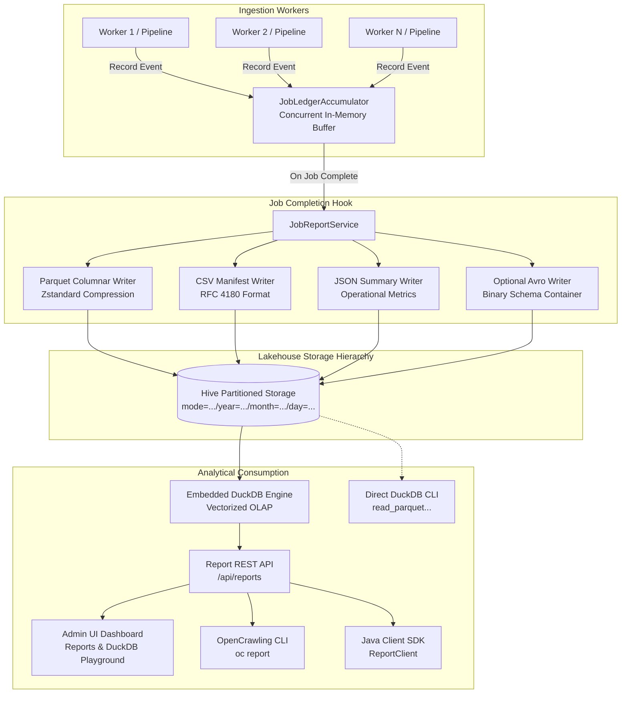

# Lakehouse Audit Reporting & Document Ledger 📊

OpenCrawling features an enterprise-grade, **Lakehouse Columnar Audit Reporting and Document Ledger** system. Every crawled and ingested document across both **RAG Pipelines** and **Archive Migration Mode** is tracked with zero runtime overhead on the ingestion workers.

Upon job completion, an immutable audit report is generated in **Apache Parquet**, **CSV Compliance Manifest**, and **JSON Operational Summary** formats, organized in Hive-partitioned directory layouts and queryable via an embedded **DuckDB** analytical engine.

---

## 🎯 Strategic Value & Compliance Capabilities

In enterprise environments handling millions of documents, compliance, cost tracking, and integrity verification are critical:

1. **WORM & Regulatory Compliance (SOC 2, HIPAA, GDPR)**: Immutable document-level manifests recording SHA-256 cryptographic checksums, source URIs, timestamps, worker IDs, and disposition statuses (SUCCESS, FAILED, SKIPPED, QUARANTINED, TOMBSTONED, MIGRATED).
2. **AI Economics & Token Governance**: Granular tracking of chunk counts, token usage, embedding models, vector dimensions, and estimated dollar costs per document and per run.
3. **Migration Verification & Bit-for-Bit Integrity**: In Migration Mode, verify that 100% of binary payloads transferred into Apache Ozone or S3 match the source byte size and SHA-256 hash before safe-pruning source documents.
4. **Zero Main-Thread Overhead**: Ingestion workers emit ledger events asynchronously to an in-memory lock-free ledger accumulator (`JobLedgerAccumulator`), eliminating database lock contention during high-throughput crawling.
5. **Serverless Analytical OLAP with DuckDB**: Embedded, in-process columnar SQL queries over local or cloud Parquet files without requiring external data warehouses (ClickHouse, Snowflake, BigQuery) or dedicated query infrastructure.

---

## 🏗️ Architecture & Processing Lifecycle



---

## 📁 Storage Layout & Hive Partitioning

Audit report artifacts are partitioned according to standard Hive/Lakehouse directory structures, allowing downstream analytical engines (DuckDB, Trino, Apache Spark, Snowflake, AWS Athena) to perform partition pruning:

```text
${opencrawling.reporting.storage.local-dir}/
├── mode=RAG/
│   └── year=2026/
│       └── month=10/
│           └── day=16/
│               ├── job_1_exec_exec-6e03d06c.parquet
│               ├── job_1_exec_exec-6e03d06c.avro       (if avro enabled)
│               ├── manifest_exec-6e03d06c.csv
│               └── summary_exec-6e03d06c.json
└── mode=MIGRATION/
    └── year=2026/
        └── month=10/
            └── day=16/
                ├── job_2_exec_exec-9f82a11b.parquet
                ├── manifest_exec-9f82a11b.csv
                └── summary_exec-9f82a11b.json
```

### Supported Storage Targets

* **`LOCAL` Filesystem**:
  * Local development: `target/reports`
  * Docker container deployments: `/data/reports` backed by the persistent volume `opencrawling-reports:/data/reports`
* **`S3` / Object Store**:
  * Direct upload to Apache Ozone S3 Gateway, AWS S3, or MinIO bucket (e.g. `opencrawling-audit-reports`).

---

## 📜 Canonical Avro & Parquet Schema Specification

All audit records adhere to the canonical schema defined in `job_execution_report.avsc`:

```json
{
  "type": "record",
  "name": "DocumentExecutionRecord",
  "namespace": "org.opencrawling.reporting.avro",
  "doc": "Audit and execution ledger record for documents processed by OpenCrawling",
  "fields": [
    { "name": "job_id", "type": "string", "doc": "Unique Job Identifier" },
    { "name": "execution_id", "type": "string", "doc": "Execution UUID for this run" },
    { "name": "pipeline_mode", "type": "string", "doc": "RAG or MIGRATION" },
    { "name": "document_id", "type": "string", "doc": "Source document unique key" },
    { "name": "source_uri", "type": "string", "doc": "Source URI or file path" },
    { "name": "connector_source", "type": "string", "doc": "Source RepositoryConnector class name" },
    { "name": "connector_target", "type": "string", "doc": "Target OutputConnector class name" },
    { "name": "status", "type": "string", "doc": "SUCCESS, FAILED, SKIPPED, QUARANTINED" },
    { "name": "duration_ms", "type": "long", "doc": "Processing latency in milliseconds" },
    { "name": "timestamp_utc", "type": "string", "doc": "ISO-8601 completion timestamp" },
    { "name": "error_code", "type": ["null", "string"], "default": null },
    { "name": "error_message", "type": ["null", "string"], "default": null },

    { "name": "rag_chunk_count", "type": ["null", "int"], "default": null },
    { "name": "rag_token_count", "type": ["null", "int"], "default": null },
    { "name": "rag_embedding_model", "type": ["null", "string"], "default": null },
    { "name": "rag_embedding_dimensions", "type": ["null", "int"], "default": null },
    { "name": "rag_vector_table", "type": ["null", "string"], "default": null },

    { "name": "mig_binary_size_bytes", "type": ["null", "long"], "default": null },
    { "name": "mig_sha256_checksum", "type": ["null", "string"], "default": null },
    { "name": "mig_target_bucket", "type": ["null", "string"], "default": null },
    { "name": "mig_target_key", "type": ["null", "string"], "default": null },
    { "name": "mig_sidecar_written", "type": ["null", "boolean"], "default": null },
    { "name": "mig_callback_http_status", "type": ["null", "int"], "default": null },
    { "name": "mig_safe_pruned", "type": ["null", "boolean"], "default": null },
    { "name": "mig_reclaimed_bytes", "type": ["null", "long"], "default": null }
  ]
}
```

### Parquet Configuration Highlights

* **Compression**: Defaults to `ZSTD` (Zstandard level 3), providing up to 90% space reduction with sub-millisecond decompression rates. (Options: `ZSTD`, `SNAPPY`, `GZIP`, `UNCOMPRESSED`).
* **Row Group Size**: Default `134217728` bytes (128 MB), optimized for large sequential analytical scans.
* **Page Size**: Default `1048576` bytes (1 MB) with dictionary encoding enabled for repeating strings (e.g., status, connector classes, MIME types).

---

## 📑 Multi-Format Artifact Outputs

For each job execution, up to 4 artifacts are generated:

### 1. Columnar Parquet (`job_<jobId>_exec_<execId>.parquet`)
Binary columnar layout for vectorized analytics and high-volume data retention.

### 2. CSV Compliance Manifest (`manifest_exec_<execId>.csv`)
RFC 4180-compliant CSV containing the exact audit trail, ideal for import into spreadsheets, legal discovery, and auditors:
```csv
job_id,execution_id,document_id,source_uri,status,duration_ms,rag_chunk_count,rag_token_count,mig_sha256_checksum,timestamp_utc
1,exec-6e03d06c,doc-001,file:///data/contract.pdf,SUCCESS,142,8,2140,,2026-10-16T10:14:22Z
1,exec-6e03d06c,doc-002,file:///data/invoice.docx,SUCCESS,98,4,950,,2026-10-16T10:14:23Z
```

### 3. Operational JSON Summary (`summary_exec_<execId>.json`)
Lightweight operational snapshot containing high-level execution statistics:
```json
{
  "executionId": "exec-6e03d06c",
  "jobId": "1",
  "jobName": "Default_Job",
  "pipelineMode": "RAG",
  "status": "COMPLETED",
  "totalDocuments": 9,
  "successfulDocuments": 9,
  "failedDocuments": 0,
  "skippedDocuments": 0,
  "durationMs": 12850,
  "totalChunks": 42,
  "totalTokens": 11840,
  "estimatedEmbeddingCostUsd": 0.002368,
  "embeddingModel": "mxbai-embed-large",
  "reportPathParquet": "mode=RAG/year=2026/month=10/day=16/job_1_exec_exec-6e03d06c.parquet",
  "reportPathCsv": "mode=RAG/year=2026/month=10/day=16/manifest_exec-6e03d06c.csv",
  "reportPathJson": "mode=RAG/year=2026/month=10/day=16/summary_exec-6e03d06c.json"
}
```

### 4. Optional Avro Container (`job_<jobId>_exec_<execId>.avro`)
Standard binary Avro file containing embedded schema headers for integration with Kafka Lakehouse connectors or Hadoop ecosystems.

---

## 🦆 Serverless Analytics with DuckDB

OpenCrawling embeds **DuckDB JDBC 1.2.x**, allowing zero-copy analytical queries directly over Parquet files.

### 1. In-App DuckDB REST API (`POST /api/reports/query`)

Send SQL queries directly to the OpenCrawling runtime:

```bash
curl -X POST http://localhost:8080/api/reports/query \
  -H "Content-Type: application/json" \
  -d '{"sql": "SELECT count(*) AS total_docs, avg(duration_ms) AS avg_latency_ms, sum(rag_token_count) AS total_tokens FROM read_parquet(\"target/reports/mode=RAG/**/*.parquet\")"}'
```

Response:
```json
{
  "columns": ["total_docs", "avg_latency_ms", "total_tokens"],
  "rows": [
    [9, 124.44, 11840]
  ]
}
```

### 2. Direct DuckDB CLI Usage

You can query the reports directory directly using the standalone DuckDB CLI:

```bash
# Query document distribution and token count
duckdb -c "SELECT status, count(*) AS doc_count, sum(rag_token_count) AS tokens FROM read_parquet('target/reports/mode=RAG/**/*.parquet') GROUP BY status;"
```

#### Output:
```text
┌─────────┬───────────┬────────┐
│ status  │ doc_count │ tokens │
│ varchar │   int64   │ int128 │
├─────────┼───────────┼────────┤
│ SUCCESS │         9 │  11840 │
└─────────┴───────────┴────────┘
```

#### Useful Analytical SQL Queries:

* **Top 5 Slowest Documents**:
  ```sql
  SELECT document_id, source_uri, duration_ms, rag_chunk_count 
  FROM read_parquet('target/reports/mode=RAG/**/*.parquet') 
  ORDER BY duration_ms DESC LIMIT 5;
  ```

* **Error Root-Cause Breakdown**:
  ```sql
  SELECT error_code, error_message, count(*) AS occurrences 
  FROM read_parquet('target/reports/**/*.parquet') 
  WHERE status = 'FAILED' 
  GROUP BY error_code, error_message;
  ```

* **Migration Checksum Validation**:
  ```sql
  SELECT mig_target_bucket, count(*) AS objects, sum(mig_binary_size_bytes) AS bytes, 
         count(mig_sha256_checksum) AS checksums_verified 
  FROM read_parquet('target/reports/mode=MIGRATION/**/*.parquet') 
  GROUP BY mig_target_bucket;
  ```

* **AI Ingestion Cost Calculation (e.g. OpenAI text-embedding-3-small at $0.02 / 1M tokens)**:
  ```sql
  SELECT rag_embedding_model, 
         sum(rag_token_count) AS total_tokens, 
         (sum(rag_token_count) / 1000000.0) * 0.02 AS total_cost_usd 
  FROM read_parquet('target/reports/mode=RAG/**/*.parquet') 
  GROUP BY rag_embedding_model;
  ```

---

## 🖥️ Admin UI "Reports & Audit Ledger" Dashboard

The OpenCrawling Admin UI includes a dedicated **Reports & Audit Ledger** interface (`/reports`):

1. **Executive KPI Cards**:
   * **Total Reports Generated**: Number of completed crawling executions.
   * **Total Documents Audited**: Accurate document counts across all runs with job deduplication metrics (`Across X runs (Y unique jobs)`).
   * **Ingestion Success Rate**: Percentage of successfully ingested vs failed documents.
   * **Total Tokens Consumed**: Aggregated token count for vector embeddings.
2. **Job Execution Reports Table**:
   * Mode badges (`RAG` vs `MIGRATION`).
   * Job Name and Execution UUID.
   * Execution status and processing duration.
   * Document counts (OK vs Failed).
   * One-click Action buttons:
     * **View Ledger**: Opens granular document modal.
     * **Download CSV**: Direct download of `manifest_exec-<id>.csv`.
     * **Download Parquet**: Direct download of columnar Parquet file.
     * **Download JSON**: Direct download of operational summary.
3. **Interactive Document Ledger Modal**:
   * Search filter by Document ID or Source URI.
   * Status filter tabs (`ALL`, `SUCCESS`, `FAILED`, `SKIPPED`).
   * Granular metadata inspection: duration ms, chunks, tokens, MIME type, error details.
   * Paginated server-side navigation.
4. **Embedded DuckDB Query Playground**:
   * Interactive SQL code editor.
   * Pre-configured templates (Summary KPIs, Token Costs, Latency Analysis, Migration Verification, Error Breakdown).
   * Fast in-browser execution against Parquet Lakehouse files.
   * Live tabular results rendering and one-click **Export to CSV**.

---

## ☕ Java Client SDK Integration (`ReportClient`)

Manage reports and query data programmatically using `client.reports()`:

```java
import org.opencrawling.sdk.OpenCrawlingClient;
import org.opencrawling.sdk.models.JobReportSummary;
import org.opencrawling.sdk.models.PaginatedLedgerResponse;
import org.opencrawling.sdk.models.QueryResult;
import java.nio.file.Path;
import java.util.List;

OpenCrawlingClient client = OpenCrawlingClient.builder()
        .baseUrl("http://localhost:8080")
        .build();

// 1. List all execution summaries
List<JobReportSummary> reports = client.reports().list();
for (JobReportSummary r : reports) {
    System.out.printf("Exec %s | Job %s | Mode: %s | Docs: %d (Success: %d, Fail: %d)%n",
            r.executionId(), r.jobId(), r.pipelineMode(), r.totalDocuments(), 
            r.successfulDocuments(), r.failedDocuments());
}

// 2. Fetch specific execution summary
client.reports().get("1", "exec-6e03d06c").ifPresent(r -> {
    System.out.println("Parquet file: " + r.reportPathParquet());
    System.out.println("Tokens consumed: " + r.totalTokens());
});

// 3. Query granular document ledger with pagination and filters
PaginatedLedgerResponse ledger = client.reports().getDocumentLedger(
        "1", "exec-6e03d06c", "FAILED", "contract", 0, 25);
ledger.items().forEach(entry -> {
    System.out.println("Failed Doc: " + entry.documentId() + " -> " + entry.errorMessage());
});

// 4. Download report artifacts to disk
client.reports().downloadToFile("1", "exec-6e03d06c", "parquet", Path.of("./job1-report.parquet"));
client.reports().downloadToFile("1", "exec-6e03d06c", "csv", Path.of("./job1-manifest.csv"));

// 5. Execute serverless DuckDB analytical query
QueryResult result = client.reports().query(
        "SELECT status, count(*) AS count FROM read_parquet('target/reports/**/*.parquet') GROUP BY status");
System.out.println("Columns: " + result.columns());
result.rows().forEach(row -> System.out.println(row));
```

---

## 💻 OpenCrawling CLI Commands (`oc report`)

The `oc` CLI provides terminal commands under the `oc report` command group:

```text
Commands:
  list     List executive summaries of all crawl executions
  get      Inspect detailed KPI report summary for a specific execution
  ledger   Query granular document-level execution ledger
  export   Download execution report in Parquet, CSV, JSON, or Avro format
  query    Execute serverless DuckDB analytical SQL query over report Lakehouse files
```

### 1. List Reports (`oc report list`)
```bash
oc report list
```
Output:
```text
+---------------------+--------+------+-----------+---------------------+----------+-----------------+--------+--------+-----------+
| EXECUTION ID        | JOB ID | MODE | STATUS    | START TIME          | DURATION | DOCS (OK/FAIL)  | CHUNKS | TOKENS | EST. COST |
+---------------------+--------+------+-----------+---------------------+----------+-----------------+--------+--------+-----------+
| exec-6e03d06c       | 1      | RAG  | COMPLETED | 2026-10-16 10:14:00 | 12s      | 9 (9/0)         | 42     | 11840  | $0.0024   |
| exec-9f82a11b       | 2      | MIG  | COMPLETED | 2026-10-16 11:20:00 | 45s      | 1500 (1500/0)   | -      | -      | -         |
+---------------------+--------+------+-----------+---------------------+----------+-----------------+--------+--------+-----------+
```

### 2. Inspect Execution Details (`oc report get`)
```bash
oc report get 1 exec-6e03d06c
```
Output:
```text
--- Execution Report: exec-6e03d06c ---
Job ID: 1 (Default_Job)
Pipeline Mode: RAG
Status: COMPLETED
Connectors: FileSystem_Local -> PGVector_Output
Timing: 2026-10-16 10:14:00 to 2026-10-16 10:14:12 (Duration: 12s)

Document Throughput:
  Total:      9
  Successful: 9
  Failed:     0
  Skipped:    0

RAG & AI Ingestion Metrics:
  Total Chunks:            42
  Total Tokens:            11840
  Estimated AI Cost (USD): $0.0024
  Embedding Model:         mxbai-embed-large

Report Artifacts:
  Parquet: mode=RAG/year=2026/month=10/day=16/job_1_exec_exec-6e03d06c.parquet
  CSV:     mode=RAG/year=2026/month=10/day=16/manifest_exec-6e03d06c.csv
  JSON:    mode=RAG/year=2026/month=10/day=16/summary_exec-6e03d06c.json
```

### 3. Inspect Document Ledger (`oc report ledger`)
```bash
oc report ledger 1 exec-6e03d06c --status SUCCESS --page 0 --size 5
```
Output:
```text
+------------------+------------------------------------+---------+--------+--------+----------+-------+
| DOCUMENT ID      | SOURCE URI                         | STATUS  | CHUNKS | TOKENS | DURATION | ERROR |
+------------------+------------------------------------+---------+--------+--------+----------+-------+
| doc-001          | file:///data/contracts/nda.pdf     | SUCCESS | 8      | 2140   | 142ms    | -     |
| doc-002          | file:///data/contracts/sla.pdf     | SUCCESS | 5      | 1200   | 98ms     | -     |
+------------------+------------------------------------+---------+--------+--------+----------+-------+
Showing 2 items | Page 0 | Total: 9
```

### 4. Export Artifacts (`oc report export`)
```bash
# Export Parquet file
oc report export 1 exec-6e03d06c --format parquet --out ./audit-run.parquet

# Export CSV Compliance Manifest
oc report export 1 exec-6e03d06c --format csv --out ./compliance-manifest.csv
```

### 5. Run Serverless DuckDB Queries (`oc report query`)
```bash
oc report query --sql "SELECT count(*) AS total_docs, avg(duration_ms) AS avg_duration_ms FROM read_parquet('mode=RAG/**/*.parquet')"
```
Output:
```text
+------------+-----------------+
| total_docs | avg_duration_ms |
+------------+-----------------+
| 9          | 124.44          |
+------------+-----------------+
✔ Query executed in 14 ms (1 rows returned)
```

---

## ⚙️ Configuration Properties Reference

Configure reporting behavior via Spring Boot properties or environment variables:

```yaml
opencrawling:
  reporting:
    enabled: true                     # Enable Lakehouse audit reporting
    storage:
      type: LOCAL                     # LOCAL or S3
      local-dir: target/reports       # Local storage directory (Docker: /data/reports)
      s3:
        endpoint: http://localhost:9878
        bucket: opencrawling-audit-reports
        region: us-east-1
    formats:
      parquet:
        enabled: true                 # Generate columnar Parquet file
        compression: ZSTD             # ZSTD, SNAPPY, GZIP, UNCOMPRESSED
        row-group-size-bytes: 134217728 # 128 MB row groups
        page-size-bytes: 1048576       # 1 MB data pages
      avro: false                     # Generate optional binary Avro file
      csv: true                       # Generate CSV compliance manifest
      json: true                      # Generate operational JSON summary
```

### Environment Variables

| Environment Variable | Spring Property | Default | Description |
|---|---|---|---|
| `SPRING_OPENCRAWLING_REPORTING_ENABLED` | `opencrawling.reporting.enabled` | `true` | Enable or disable audit reporting |
| `SPRING_OPENCRAWLING_REPORTING_STORAGE_TYPE` | `opencrawling.reporting.storage.type` | `LOCAL` | Storage engine (`LOCAL` or `S3`) |
| `SPRING_OPENCRAWLING_REPORTING_LOCAL_DIR` | `opencrawling.reporting.storage.local-dir` | `target/reports` | Local disk folder (Docker: `/data/reports`) |
| `SPRING_OPENCRAWLING_REPORTING_S3_ENDPOINT` | `opencrawling.reporting.storage.s3.endpoint` | `http://localhost:9878` | S3 or Apache Ozone gateway endpoint |
| `SPRING_OPENCRAWLING_REPORTING_S3_BUCKET` | `opencrawling.reporting.storage.s3.bucket` | `opencrawling-audit-reports` | Target bucket name for audit artifacts |
| `SPRING_OPENCRAWLING_REPORTING_S3_REGION` | `opencrawling.reporting.storage.s3.region` | `us-east-1` | S3 signing region |
| `SPRING_OPENCRAWLING_REPORTING_FORMATS_PARQUET_ENABLED` | `opencrawling.reporting.formats.parquet.enabled` | `true` | Generate columnar Parquet files |
| `SPRING_OPENCRAWLING_REPORTING_FORMATS_PARQUET_COMPRESSION` | `opencrawling.reporting.formats.parquet.compression` | `ZSTD` | Codec (`ZSTD`, `SNAPPY`, `GZIP`, `UNCOMPRESSED`) |
| `SPRING_OPENCRAWLING_REPORTING_FORMATS_PARQUET_ROW_GROUP_SIZE_BYTES` | `opencrawling.reporting.formats.parquet.row-group-size-bytes` | `134217728` | Row group buffer size in bytes (128 MB) |
| `SPRING_OPENCRAWLING_REPORTING_FORMATS_PARQUET_PAGE_SIZE_BYTES` | `opencrawling.reporting.formats.parquet.page-size-bytes` | `1048576` | Column page size in bytes (1 MB) |
| `SPRING_OPENCRAWLING_REPORTING_FORMATS_AVRO` | `opencrawling.reporting.formats.avro` | `false` | Generate binary Avro files |
| `SPRING_OPENCRAWLING_REPORTING_FORMATS_CSV` | `opencrawling.reporting.formats.csv` | `true` | Generate CSV compliance manifests |
| `SPRING_OPENCRAWLING_REPORTING_FORMATS_JSON` | `opencrawling.reporting.formats.json` | `true` | Generate JSON operational summaries |

---

## 🐳 Docker Deployment & Persistent Volumes

When deploying OpenCrawling in Docker or Kubernetes, persist the reports directory across container restarts using a dedicated volume:

```yaml
services:
  opencrawling-runtime:
    image: opencrawling/oc-runtime:latest
    environment:
      - SPRING_OPENCRAWLING_REPORTING_ENABLED=true
      - SPRING_OPENCRAWLING_REPORTING_STORAGE_TYPE=LOCAL
      - SPRING_OPENCRAWLING_REPORTING_LOCAL_DIR=/data/reports
    volumes:
      - opencrawling-reports:/data/reports

volumes:
  opencrawling-reports:
```

---

## 🧪 Integration Testing with Decoupled Docker Stack

OpenCrawling provides an automated, end-to-end integration test script for verifying the reporting subsystem in a decoupled multi-container deployment:

```bash
./scripts/test-reporting-decoupled.sh
```

### Verified Test Assertions:
1. **Cluster Lifecycle**: Boots the decoupled multi-service infrastructure (`PostgreSQL` + `pgvector`, `Redis`, `Ollama`, `Kafka`, `oc-crawler`, `oc-ingestion-consumer`, `oc-embedding-consumer`, `oc-writer-consumer`, and `oc-mcp-server`) via `docker-compose-decoupled.yml`.
2. **End-to-End Ingestion**: Seeds test documents into the mounted `/data` directory, executes directory crawling, and verifies that Kafka consumers asynchronously process chunks and store vectors in PostgreSQL pgvector.
3. **Lakehouse Volume Verification**: Asserts generation of Hive-partitioned `.parquet`, `manifest_*.csv`, and `summary_*.json` files on the shared volume (`opencrawling-reportsdata:/data/reports`).
4. **REST API Endpoints**:
   - `GET /api/reports`: Returns valid JSON summaries.
   - `GET /api/reports/{jobId}/{executionId}`: Detailed execution KPI inspection.
   - `GET /api/reports/{jobId}/{executionId}/documents`: Paginated document ledger with status filtering (`?status=SUCCESS`) and query search (`?query=...`).
   - `GET /api/reports/{jobId}/{executionId}/export`: Exports CSV manifest, JSON summary, and binary Parquet with `PAR1` magic bytes.
5. **Serverless DuckDB Queries**: Asserts analytical SQL queries (`POST /api/reports/query`) directly over Parquet files (document count, average duration, status distribution).
6. **OpenCrawling CLI Commands**: Executes `oc report` CLI subcommands (`list`, `get`, `ledger`, `export`, `query`).

